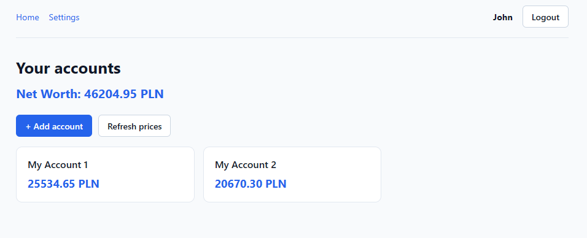

# Networth Tracker

## What does this project do?
Networth Tracker is a web application built with Django that helps users track their accounts and calculate their total net worth in one place. It is especially useful for combining asset information from multiple brokerage accounts. Because the code is open source, you can self-host it and keep your sensitive financial data under your own control instead of trusting a third-party provider. Users can manage their accounts and assets, fetch live market prices, and view everything converted into their preferred display currency.

### Main features
- **User authentication** – registration, login, logout, and account deletion.
- **Account management** – create, rename, and delete accounts (e.g., brokerage, savings, crypto).
- **Asset management** – add, edit (name, ticker, quantity, price), and delete assets inside each account.
- **Live market prices** – automatic price updates and currency conversion using Yahoo Finance (`yfinance`).
- **Display currency settings** – switch the main net worth currency (e.g., PLN, USD, EUR) at any time.

### Tech stack
- **Backend:** Python, Django
- **Database:** PostgreSQL
- **Frontend:** HTML, CSS, Vanilla JavaScript (Django Templates)
- **External API:** `yfinance` (Yahoo Finance)

---

## What does it look like?


### Dashboard (Accounts & Net Worth)


### Account Details & Assets


---

## Where can I watch it live?
The live version of the app is available here:  
👉 **[Live Demo](http://srv61.mikr.us:30191/)**


---


## Prerequisites

Before running the project locally, make sure you have the following installed:

- [Git](https://git-scm.com/)
- [Docker](https://docs.docker.com/get-docker/) & [Docker Compose](https://docs.docker.com/compose/install/) (v2+)

## How do I run it?

1. **Clone the repository**

   ```bash
   git clone [https://github.com/YOUR_USERNAME/networth-tracker.git](https://github.com/YOUR_USERNAME/networth-tracker.git)
   cd networth-tracker
   ```

2. **Configure environment variables**

   Create a `.env` file based on the provided template and fill in your values (such as `SECRET_KEY`, database credentials, and `ADMIN_URL`):

   ```bash
   cp .env.example .env
   ```

   > **Note:** For local development, keep `APP_PORT=8000`, `DEBUG=True`, and `CSRF_TRUSTED_ORIGINS=http://localhost:8000`.

3. **Build and start the containers**

   ```bash
   docker compose up -d --build
   ```

4. **Apply database migrations and collect static files**

   ```bash
   docker compose exec web python manage.py migrate
   docker compose exec web python manage.py collectstatic --noinput
   ```

5. **Create an admin account (optional)**

   ```bash
   docker compose exec web python manage.py createsuperuser
   ```

6. **Access the application**

   - **App:** `http://localhost:8000`
   - **Admin panel:** `http://localhost:8000/<your-ADMIN_URL>`


